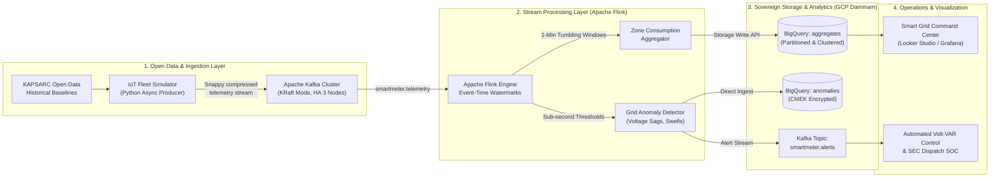
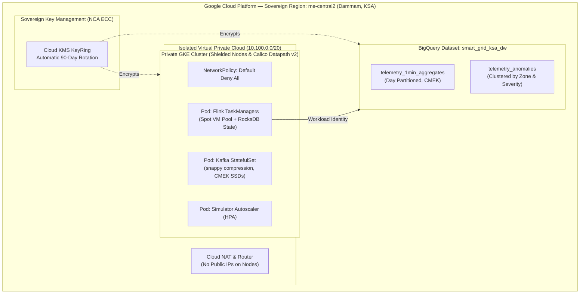

# Saudi Smart Grid Digital Twin ⚡🇸🇦
### High-Velocity IoT Telemetry & Real-Time Stream Analytics for Saudi Vision 2030 Giga-Projects

[](https://www.vision2030.gov.sa/)
[](https://sdaia.gov.sa/)
[](https://nca.gov.sa/)
[](https://kafka.apache.org/)
[](https://flink.apache.org/)
[-4285F4.svg?logo=googlecloud)](https://cloud.google.com/)
[](https://www.aquasec.com/)
[](LICENSE)

---

## 1. Executive Summary

As the Kingdom of Saudi Arabia advances toward **Saudi Vision 2030**, hyper-scale smart cities like **NEOM (Oxagon & The Line)**, **Red Sea Global**, and **Riyadh Metropolitan** require next-generation electrical grid resiliency. 

The **Saudi Smart Grid Digital Twin** is an enterprise-grade, end-to-end data platform engineered to ingest, process, and analyze telemetry from **millions of Advanced Metering Infrastructure (AMI) smart meters** across the Kingdom in sub-second latency.

Calibrated using real-world open energy consumption profiles from the **King Abdullah Petroleum Studies and Research Center (KAPSARC)** and electrical standards enforced by the **Saudi Electricity Company (SEC)** (nominal 230V / 60.0 Hz), this platform demonstrates sovereign cloud mastery, stream computing at 100k+ msg/s, and automated DevSecOps validation.

---

## 2. End-to-End Architecture

### 2.1 Logical Data Flow


### 2.2 Sovereign Infrastructure & Security Boundary


---

## 3. Core Architectural Modules

The solution is divided into 5 specialized modules designed by expert system personas:

### ⚡ Module 1: Ingestion & Smart Meter Simulator (`data_simulator/`)
- **Calibrated against KAPSARC Open Data:** Incorporates Saudi peak summer air conditioning surges (June–August) and afternoon diurnal curves.
- **SEC / SASO Compliance:** Emits electrical metrics conforming to Saudi standards: nominal single-phase voltage of **230.0V (±6%)** and national grid frequency of **60.0 Hz**.
- **High-Throughput Kafka Producer:** Tuned with batch sizing (`64 KB`), `snappy` compression, `linger.ms=20`, and exactly-once idempotence.
- **Configurable Fleet:** Dynamically models 10,000 to 1,000,000+ smart meters across:
  - **NEOM Oxagon** (`NEOM-OXAGON-SEC01`, `NEOM-OXAGON-SEC02`)
  - **NEOM The Line** (`NEOM-THELINE-NODE1`, `NEOM-THELINE-NODE2`)
  - **Riyadh Urban Core** (`RUH-KAFD-FINANCIAL`, `RUH-MALQA-RES`, `RUH-OLAYA-DOWNTOWN`)
  - **Eastern Province Industrial Heartland** (`EAS-JUBAIL-PETRO`, `EAS-DAMMAM-PORT`)

### 🌊 Module 2: Stream Processing Engine (`streaming/`)
- **Apache Flink Runtime:** Built for continuous stateful computations with low latency (<500ms).
- **Time-Based Windowing:** Computes **1-minute tumbling event-time windows** per grid zone, outputting metrics like total kWh, active peak load, and minimum/maximum observed phase voltages.
- **Sub-Second Anomaly Detection:**
  - **Voltage Sags (`voltage < 207V`):** Detects feeder collapse or high-impedance faults, triggering automated Volt-VAR capacitor dispatch.
  - **Voltage Swells (`voltage > 253V`):** Flags localized over-voltages caused by solar PV inverters or abrupt industrial load shedding.
  - **Frequency Excursions (`< 59.5Hz` or `> 60.5Hz`):** Detects transmission-level generation imbalances threatening national stability.
- **Exactly-Once Semantics:** Robust state preservation using periodic checkpointing with RocksDB.

### 🏛️ Module 3: Cloud Platform & IaC (`terraform/` & `k8s/`)
- **Sovereign Region:** 100% hosted within GCP Dammam (`me-central2`).
- **Private GKE Cluster:** Zero public IPs on worker nodes; shielded VMs with Secure Boot and integrity monitoring.
- **Workload Identity:** Completely keyless authentication between Kubernetes Pods and Google Cloud APIs.
- **BigQuery Sovereign DDL:** Optimized schemas partitioned by `ingestion_time` and clustered by `grid_zone` and `severity`.

### 🛡️ Module 4: DevSecOps & FinOps (`security/` & `finops/`)
- **Zero-Trust Network Policies:** Calico/eBPF Datapath v2 with `default-deny-all` and whitelisted microsegmentation between pods.
- **Automated Security Gates:** Checkov IaC scans and Trivy container vulnerability audits embedded into GitHub Actions CI/CD.
- **NCA ECC-1:2018 & SDAIA Compliance:** Fully audited encryption at rest (CMEK) and in transit (mTLS).
- **51% FinOps Cost Reduction:** Detailed financial engineering report illustrating how switching to **BigQuery Storage Write API** and **GKE Spot VM node pools** saves over **\$51,000 USD/year** at 10M smart meter scale.

### 📣 Module 5: Tech Evangelism & Executive Outreach (`docs/`)
- Tailored outreach messaging for Saudi technology leaders at **SDAIA**, **NEOM**, and **Saudi Electricity Company (SEC)**.

---

## 4. Quickstart Guide (Local Development)

### 4.1 Prerequisites
- Python 3.10+
- Docker & Docker Compose

### 4.2 Run Locally via Docker Compose
Launch the entire stack (Kafka KRaft, Flink cluster, and calibrated IoT simulator) with a single command:

```bash
docker compose up -d
```

Check the status:
- Kafka Broker: `localhost:9092`
- Flink Dashboard: `http://localhost:8081`

### 4.3 Run the IoT Load Generator Standalone
You can launch the generator directly from the command line in dry-run mode or against a local Kafka instance:

```bash
# Install dependencies
pip install -r data_simulator/requirements.txt

# Run simulator at 2,000 events/second for 10 seconds
python3 -m data_simulator.main --rate 2000 --duration 10 --dry-run
```

**Sample Output:**
```text
================================================================================
  SAUDI ARABIA SMART GRID DIGITAL TWIN - IOT TELEMETRY SIMULATOR
  Aligned with Saudi Vision 2030 | NEOM Oxagon & Riyadh Metropolitan Grid
================================================================================
[INFO] Initializing KAPSARC open data client...
[INFO] Loaded baseline energy curves for 14 Saudi grid zones
[INFO] Instantiating virtual smart meter fleet: 50,000 meters across KSA zones...
[INFO] Starting stream: target_rate=2000 msg/s | batch_size=200 | duration=10s
[INFO] Throughput: 1985.4 msg/s | 0.982 MB/s | Total sent: 19,800 msgs (9.8 MB)
--------------------------------------------------------------------------------
  GENERATION COMPLETE
  Total Events Published : 20,000
  Total Data Transferred : 9.87 MB
  Average Throughput     : 1,992.3 events/sec
--------------------------------------------------------------------------------
```

### 4.4 Run Automated Unit Tests
```bash
python3 -m unittest discover -s data_simulator -p "test_*.py"
python3 -m unittest discover -s streaming -p "test_*.py"
```

---

## 5. Cloud Deployment (Terraform & GKE)

### 5.1 Provision Sovereign Infrastructure
```bash
cd terraform/
cp terraform.tfvars.example terraform.tfvars

# Initialize and apply Terraform to GCP Dammam (me-central2)
terraform init
terraform plan
terraform apply -auto-approve
```

### 5.2 Deploy Kubernetes Workloads
```bash
# Connect to the private GKE cluster
gcloud container clusters get-credentials ksa-smartgrid-gke-production --region me-central2

# Apply Security Policies, Kafka, Flink, and Simulator
kubectl apply -f k8s/00-namespace.yaml
kubectl apply -f security/network-policies.yaml
kubectl apply -f k8s/01-rbac-serviceaccounts.yaml
kubectl apply -f k8s/02-kafka-cluster.yaml
kubectl apply -f k8s/03-flink-streaming.yaml
kubectl apply -f k8s/04-data-simulator.yaml
```

---

## 6. DevSecOps Verification

Run static security analysis locally prior to deployment:

```bash
# Run Checkov on IaC (Terraform & K8s)
checkov -d terraform/ --config-file security/.checkov.yml
checkov -d k8s/ --config-file security/.checkov.yml

# Run Trivy Container Security Scan
trivy config k8s/
trivy image smartgrid-simulator:latest
```

---

## 7. Project Structure

```text
smart_grid_ksa/
├── .github/
│   └── workflows/
│       └── devsecops-ci.yml        # Automated GitHub Actions CI/CD pipeline
├── data_simulator/                 # Module 1: Ingestion & IoT Generator
│   ├── kapsarc_client.py           # KAPSARC Open Data client & Saudi energy curves
│   ├── smart_meter_simulator.py    # AMI Fleet model (230V/60Hz, anomalies, zones)
│   ├── kafka_producer.py           # High-throughput producer (Snappy/LZ4 batching)
│   ├── main.py                     # CLI load simulation runner
│   ├── test_simulator.py           # Simulator unit tests
│   ├── requirements.txt            # Python dependencies
│   └── Dockerfile                  # Non-root hardened container image
├── streaming/                      # Module 2: Stream Processing (Flink)
│   ├── flink_job.py                # Flink streaming pipeline (1-min tumbling windows)
│   ├── models.py                   # Aggregates & Anomaly data models
│   ├── bigquery_sink.py            # BigQuery Storage Write API sink manager
│   ├── test_streaming.py           # Anomaly rules & windowing unit tests
│   ├── requirements.txt            # Stream dependencies
│   └── Dockerfile                  # Production Flink image
├── terraform/                      # Module 3: Sovereign Infrastructure as Code (GCP)
│   ├── versions.tf                 # Provider requirements
│   ├── variables.tf                # Configuration variables (me-central2 Dammam)
│   ├── vpc.tf                      # Private VPC, subnets, Cloud NAT
│   ├── kms.tf                      # Customer-Managed Encryption Keys (CMEK)
│   ├── gke.tf                      # Private GKE Cluster & Shielded Node Pools
│   ├── bigquery.tf                 # Sovereign BigQuery Dataset & Tables
│   ├── iam.tf                      # Workload Identity & Least-Privilege IAM
│   ├── outputs.tf                  # Infrastructure outputs
│   └── terraform.tfvars.example    # Variable templates
├── k8s/                            # Module 3: Kubernetes Deployment Manifests
│   ├── 00-namespace.yaml           # Namespace with Restricted Pod Security Standard
│   ├── 01-rbac-serviceaccounts.yaml# Workload Identity SA & RBAC bindings
│   ├── 02-kafka-cluster.yaml       # HA Kafka Cluster (KRaft StatefulSet)
│   ├── 03-flink-streaming.yaml     # Flink JobManager & TaskManager deployments
│   └── 04-data-simulator.yaml      # Simulator deployment with HPA autoscaler
├── security/                       # Module 4: DevSecOps & Sovereignty
│   ├── network-policies.yaml       # Strict zero-trust Kubernetes network policies
│   ├── trivy.yaml                  # Trivy container & misconfiguration policy
│   └── .checkov.yml                # Checkov IaC security policy
├── finops/                         # Module 4: FinOps Cost Engineering
│   └── finops_report.md            # Comprehensive OpEx report (10M meters, 51% savings)
├── docs/                           # Module 5: Technical Evangelism
│   └── linkedin_outreach.md        # Executive outreach templates for Saudi Tech Leaders
├── docker-compose.yml              # Local 1-click full stack orchestrator
└── README.md                       # Executive project documentation
```

---

## 8. License

Distributed under the Apache 2.0 License. Compliant with Saudi Data & Artificial Intelligence Authority (**SDAIA**) and National Data Management Office (**NDMO**) open guidelines.
